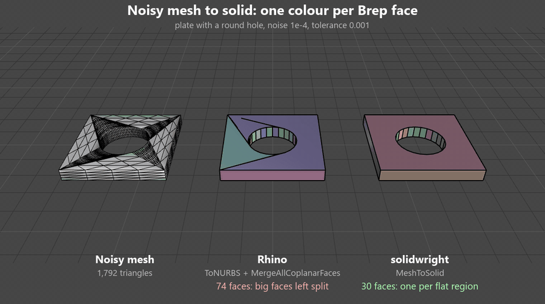

# solidwright

Turn rough meshes into clean, verified solids for Rhino and Grasshopper.



*A noisy mesh of a plate with a round hole, rebuilt by Rhino (74 faces, its big
faces left split into pieces) and by solidwright's `MeshToSolid` (30 faces, one
per flat region). Each Brep face has its own colour. Captured in Rhino 8.*

solidwright is a set of Grasshopper components and the Python library behind
them. It checks meshes, finds how a part sits, rebuilds faceted meshes as
exact solids, builds clearance solids around parts, and wraps a few Rhino
operations that fail quietly (Boolean union and difference, Sweep1) in checks that say
when they did. Every component reports how it went.

## Components

**Meshes and parts**

- **MeshHealth**: checks a mesh and cleans what can be cleaned safely:
  welds vertices, removes zero-area and duplicate faces, drops loose junk,
  makes face directions consistent. Then grades what is left (holes, extra
  pieces, non-manifold edges).
- **NaturalAxis**: the direction a part obviously sits along (the axis of
  a turned or faceted body, the normal of a plate), at any orientation, or
  a check of an axis you give it.
- **ProfileFit**: a part's side outline and where it bends, as a
  three-piece broken line.
- **SizeGroups**: sorts parts into size groups, by reference parts, by a
  count, or by gaps in size.

**Solids**

- **MeshToSolid**: a closed Brep with one exact flat face per planar region
  of a mesh, convex or not, holes included (see the comparison with Rhino
  below).
- **OffsetSolid**: a closed solid around a faceted convex part, every facet
  pushed out by a clearance (sideways only, or all round).
- **ClearanceSolid**: a closed solid around any part, curved and scanned
  ones included, built from cross sections kept a clearance away sideways.
- **DomeCap**: rounded caps on flat outlines, or a part cut by a plane and
  capped.

**Booleans, sweeps and shaping**

- **VerifiedUnion**: Boolean union of many solids, one at a time, every
  result checked so a piece the union silently dropped is caught.
- **VerifiedDifference**: Boolean difference with many cutters, the ones
  that break it isolated and rescued, every result checked so a cutter the
  difference silently skipped is caught.
- **RobustSweep**: a one-rail sweep that places and aligns the sections
  itself and falls back through several methods, reporting which one
  worked.
- **Deform**: compresses, curls or radially fits parts above a height along
  an axis.
- **StackAlongAxis**: lines parts up end to end along any axis with a fixed
  gap.

Every component has three extra outputs:

| Output | Meaning |
|---|---|
| `Status` | 0 good, 1 warning (usable, worth a look), 2 messy (made from questionable input or by a fallback), 3 failed (no trustworthy result) |
| `OK` | True for status 0 or 1 |
| `Info` | every reason, one per line |

Warnings and errors also show as the component's orange or red balloon.

## Install

solidwright is plain Python with no dependencies. Download or clone this
repository, then make the `solidwright` folder (the one inside the
repository, holding `core`, `rhino` and `gh`) importable:

- **Rhino 8**: copy the `solidwright` folder into
  `%APPDATA%\McNeel\Rhinoceros\8.0\scripts`. Rhino 8 puts that folder on the
  search path of both its Pythons (IronPython 2 and Python 3); checked with
  `RunPythonScript` in each.
- **Anywhere else** (Rhino 7 GHPython, a folder of your choice): add the
  repository folder to the search path at the top of a script:

  ```python
  import sys
  sys.path.append(r"C:\path\to\solidwright-repository")
  ```

Rhino keeps imported modules loaded for the whole session, so restart Rhino
after updating the folder.

## Using a component

Each file in `components/` is one Grasshopper component.

1. Add a script component: in Rhino 8 the **Script** component (Python 3 or
   IronPython 2), in Rhino 7 the **GhPython Script** component.
2. Open its editor and paste the whole file in.
3. Zoom in on the component and set its inputs and outputs to match the
   list at the top of the file: same names, and **List Access** where it says
   "list access". Type hints help (Mesh, Brep, Curve...).

Inputs marked optional can be left unconnected or removed from the
component.

## Supported versions

| Rhino | Python | Status |
|---|---|---|
| Rhino 8 | IronPython 2.7.12 | tested |
| Rhino 8 | Python 3.9.10 | tested |
| Rhino 7 | IronPython 2.7 (GhPython) | written for it, not tested yet |

"Tested" means every component script was run inside Rhino 8 on real
geometry, from a Python script that feeds it inputs the way Grasshopper
does.

The library itself (`solidwright.core`) is tested in CI on Python 3.9 and
3.12 and is written to run unchanged in IronPython 2.7.

## Principles

- **Every result is graded.** Tools return a report with a status (0 good,
  1 warning, 2 messy, 3 failed) and readable reasons, instead of raising or
  quietly handing back bad geometry.
- **Pure-Python core.** `solidwright.core` has no Rhino and no numpy imports, so
  it runs in GHPython (IronPython 2.7), Rhino 8 CPython and plain CPython.
  Thin adapters in `solidwright.rhino` convert to and from RhinoCommon.
- **Tested without Rhino.** Tests use procedural geometry and a small mock of
  the RhinoCommon pieces the adapters touch.

## Planar mesh to solid, compared with Rhino

`MeshToSolid` turns a closed mesh of a part made of flat faces into a Brep
with one exact flat face per planar region (parts that are not convex and
faces with holes included). Rhino's own route is `ToNURBS` followed by
`MergeAllCoplanarFaces`. Both were run in Rhino 8 on the same meshes, each
tilted 37 degrees and moved off the origin, with a tolerance of 0.001 and
Rhino's default 1 degree angle tolerance. The test parts are 1 to 4 units
across; the meshes are dense (every face split into many triangles), with
random noise added to the vertices or stored in single precision far from
the origin, as an STL export there would be.

*Corners off* is how far the result's corners are from the true solid (the
largest distance, in model units).

| Part | Mesh | Right faces | solidwright faces | corners off | time | Rhino faces | corners off | time |
|---|---|---:|---:|---:|---:|---:|---:|---:|
| box | noise 1e-4 | 6 | 6 | 7.5e-5 | 0.01 s | 6 | 1.6e-4 | 0.06 s |
| L block | noise 1e-4 | 8 | 8 | 1.3e-4 | 0.02 s | 8 | 1.8e-4 | 0.13 s |
| U block | noise 1e-4 | 10 | 10 | 1.0e-4 | 0.03 s | 10 | 2.4e-4 | 0.22 s |
| frame (square hole) | noise 1e-4 | 10 | 10 | 1.3e-4 | 0.04 s | 10 | 1.7e-4 | 0.29 s |
| faceted part | noise 1e-4 | 65 | 65 | 1.5e-4 | 0.16 s | **221** | 3.0e-4 | 3.0 s |
| plate, round hole | noise 1e-4 | 30 | 30 | 8.7e-5 | 0.16 s | **74** | 2.9e-4 | 4.3 s |
| box | single precision, far | 6 | 6 | 9.9e-6 | 0.01 s | 6 | 6.1e-5 | 0.06 s |
| L block | single precision, far | 8 | 8 | 2.5e-5 | 0.02 s | 8 | 3.6e-5 | 0.13 s |
| U block | single precision, far | 10 | 10 | 2.5e-5 | 0.02 s | 10 | 5.0e-5 | 0.21 s |
| frame (square hole) | single precision, far | 10 | 10 | 1.3e-5 | 0.03 s | 10 | 6.1e-5 | 0.27 s |
| faceted part | single precision, far | 65 | 65 | 3.0e-5 | 0.10 s | **91** | 5.9e-5 | 2.6 s |
| plate, round hole | single precision, far | 30 | 30 | 2.9e-5 | 0.15 s | **35** | 6.2e-5 | 4.0 s |

- **Clean meshes:** both give the same faces and edges, and both are exact
  (corners within 2e-14).
- **Light noise (1e-5):** both find the right faces. solidwright's corners
  are 1.1 to 2.5 times closer, because each corner is solved from the
  refitted planes that meet there instead of being taken from one noisy
  vertex.
- **Heavier noise (1e-4) and single precision far from the origin:**
  Rhino leaves faces split into pieces on the parts with many or narrow
  faces. solidwright keeps them whole by joining neighbouring pieces while
  they stay flat within half the tolerance. Its corners are closer in every
  case, up to 6 times.
- **Validity:** every result from both is a valid closed solid with no open
  edges. The largest edge tolerance in a solidwright result was 7.9e-5 (the
  noisy faceted part); Rhino's were 0.
- **A Rhino-meshed CAD part** (a box with a cylinder hole, single precision
  render mesh): both give 46 faces; corners off 1.6e-7 (solidwright) and
  3.4e-7 (Rhino).
- **Speed:** times are for Rhino 8's CPython. In IronPython (GHPython)
  solidwright took about the same, after about 0.3 s of start-up on its
  first run. The real `ToNURBS` and `MergeAllCoplanarFaces` commands gave
  the same results as their RhinoCommon calls, slightly slower.
- **Noise beyond the tolerance:** when the noise is too large for faces to
  be flat within half the tolerance, solidwright cannot join them either. It
  then reports that the mesh looks noisier than the tolerance instead of
  grading the result good.

## Write-ups

Short notes on the problems that took the most thought, with numbers:

- [The mirror-plane trap](docs/mirror-plane-trap.md): why a side view of a
  symmetric part looks as level as its true axis, and what decides.
- [Why interpolating between sections cuts into the part](docs/interpolation-cuts-between-kinks.md):
  a section-based solid needs a level wherever any side bends.
- [Split corners and the validated merge](docs/split-corners-and-validated-merge.md):
  why pushing faces out splits shared corners, and how the merge is checked.
- [Verified union](docs/verified-union.md): why "it ran" is not "it worked"
  for a Boolean union, and what Rhino actually returns.
- [Verified difference](docs/verified-difference.md): a closed solid is not
  proof of a complete cut; what Rhino returns, and the checks that catch a
  skipped cutter.

## Layout

```
solidwright/
  core/     pure Python geometry: no Rhino, no numpy (IronPython 2.7 and Python 3)
  rhino/    thin adapters between RhinoCommon and the core
  gh/       input and message helpers for Grasshopper components
components/ one Grasshopper component script per tool
tests/      pytest, with procedural test geometry and a small RhinoCommon mock
docs/       the write-ups
```

## Running the tests

```
python -m pip install pytest numpy scipy
python -m pytest
```

## License

MIT. See [LICENSE](LICENSE).
