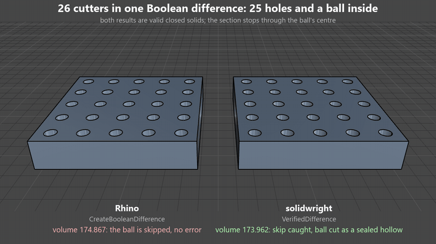

# Verified difference: a closed solid is not proof of a complete cut

A Boolean difference with many cutters fails the same two ways a union does.
The loud way: the call returns nothing. The quiet way: it returns a Brep
that looks fine and is not, either an open Brep or a valid closed solid with
one cutter left out. The second kind is worse, because the missing cut only
shows up later, on the finished part.

`VerifiedDifference` tries all cutters in one call, isolates the ones that
break it, rescues those one at a time, and checks every result before
keeping it.

## What Rhino actually returns

Measured with `Brep.CreateBooleanDifference` in Rhino 8 (identical in
IronPython 2.7 and Python 3.9), on a 10 x 10 x 2 plate, volume 200:

| Cutter | Plain result |
|---|---|
| box through the plate | 1 solid, volume 192 (correct) |
| pocket flush with the top face | 1 solid, volume 196 (correct) |
| hole flush with top and bottom | 1 solid, volume 192 (correct) |
| notch flush with a side face | 1 solid, volume 196 (correct) |
| ball wholly inside | **nothing** |
| apart | nothing |
| touching a face or an edge from outside | 1 solid, volume 200 (correct) |
| swallows the plate | nothing (correct: nothing is left) |
| cuts it in two | 2 solids, 80 + 80 (correct) |

Flush faces were not a problem for planar cutters. Two cases did go wrong:

| Many cutters | Plain result | `VerifiedDifference` |
|---|---|---|
| 5 round holes that touch each other along lines | 1 Brep, **open**, volume 168.584 | 7 solids, 168.289, each hole over-cut 0.009 (warning) |
| 25 holes and a ball inside | 1 **closed solid**, volume 174.867: the ball is **skipped** | 1 solid, 174.754, the ball left as a sealed hollow (warning) |

The second row is the quiet failure: a valid closed solid with the right
look and the wrong volume. Nothing in the result says a cutter was dropped.

*The same plate with a larger ball (radius 0.6) inside, cut through the
ball's centre. Rhino: volume 174.867, the ball skipped. `VerifiedDifference`:
173.962, the ball cut as a sealed hollow.*

## What a result must pass

Every piece is a valid closed solid, and:

1. **The volume adds up.** It did not grow, and it did not lose more than
   the cutters hold.
2. **The pieces stay inside the solid's bounding box.**
3. **No cutter was skipped.** Before cutting, points just inside each
   cutter's surface (10 x the tolerance in) that are also inside the solid
   are kept as probes. After the cut, no probe may be inside the result.
   This is the check that caught the skipped ball.
4. **No part of the result lies inside a cutter.** Points just inside the
   result's surface must be outside every cutter.

Sample points sit 10 x the tolerance off a surface, never on it, so the
inside tests never have to decide about a point lying on a surface.

## When it fails

All cutters go in one call at the tolerance, twice it, and a tenth of it.
When all three fail, the cutters are split in halves until the ones that
break the call are isolated; the rest still go through in bulk. A cutter
that fails on its own climbs a rescue ladder, and the first result that
passes the checks wins:

| Rescue | Reported as |
|---|---|
| a sealed hollow, when the cutter lies wholly inside and touches nothing | warning |
| twice, then a tenth of the tolerance | note |
| the job scaled up 10 times and back | note |
| the cutter grown by 5 x the tolerance, per axis, then uniformly | warning, with the largest over-cut |
| 10 x the tolerance | warning |

A cutter that still fails is left out of the result and named in `Failed`,
with the reason for every rung. The status is then messy and `OK` is False.

## Cost

| Case | Plain | `VerifiedDifference` |
|---|---:|---:|
| 25 through holes | 0.05 s | 0.5 s |
| 25 holes and 16 pockets | 0.08 s | 0.7 to 0.9 s |
| 25 holes and a ball inside (13 Boolean calls) | 0.05 s | 2.7 s |

About 10 times slower when nothing goes wrong, for a result that is known
to hold every cut.

## Testing without Rhino

The scheduler in `solidwright.core.difference_plan` never calls Rhino. It
takes the geometry calls as an object, so the tests use stand-in solids
made of unit cubes, where difference, volume and point inclusion are exact,
and play Rhino's failures on purpose: a call that refuses always, at one
tolerance, unless scaled up or unless the cutter is grown; one that skips a
cutter quietly; one that returns an open or bloated piece; and one that
returns nothing for a cutter wholly inside, as Rhino does.
